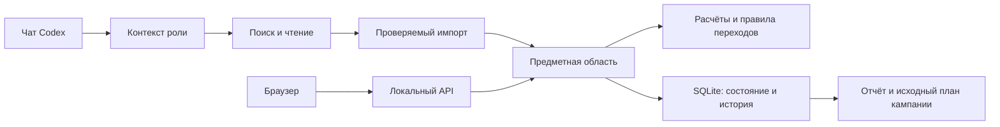

# Архитектура локального MVP 0.3

Дополнение **2026-10-03**: `quality.py` хранит версии измерительного протокола и оценок людей, строит проверку полноты и запросы отделам; `activation.py` реализует реестр условий, применимость пулов, объёмы, зависимости и подтверждение задач. `activation_catalog.json` содержит исходные 16 пулов/48 шаблонов. Дополнительные списки JSON необязательны для старых документов; обновление не переписывает их. CLI `handoff` читает SQLite в `mode=ro`; `activation --file` и `POST /api/activation` создают прямую карточку исполнения. `GET /api/research/{id}/handoff` возвращает Markdown-запросы. [Поведение и границы](../product/proverka-i-ispolnenie.md).

Дата: 2026-10-01. Статус: реализовано и локально проверено. Окончательный стек командного веб-продукта не утверждён.

## Назначение и компоненты

Шесть этапов связаны в сохраняемый процесс. Владелец работает через браузер, Codex — через CLI. Сетевое исследование выполняет ассистент доступными инструментами Codex. Приложение хранит результаты и проверяет структуру, источники и границы действий.

| Компонент | Реализация | Что делает |
| --- | --- | --- |
| Интерфейс | apps/web/, HTML/CSS/JavaScript | Бриф, источники, пул, пакеты, решения, задачи, результаты |
| API | apps/api/server.py | Локальные запросы и версия перед записью |
| Предметная область | packages/domain/ | Валидация, этапы, ограничения ролей, отчётность |
| Хранилище | packages/domain/store.py, SQLite | Транзакции, снимки и журнал действий |
| Расчёты | packages/scoring/engine.py | Фиксированная шкала, пропуски, экономика и допуск к рейтингу |
| Диагностика | packages/scoring/diagnostics.py, diagnostic_report.py | Чувствительность пар, границы, запросы данных и отчёт HTML/Markdown/JSON из одной revision; отдельное чтение SQLite без записи |
| Поиск | packages/connectors/legacy.py | План и импорт прежних досье; сетевых вызовов здесь нет |
| Роли | agents/workflow.json, packages/domain/agents.py | Контекст и проверка результата роли |
| CLI | sponsor.py | Создание, действия, экспорт, задачи ролям, история |

Для локального этапа выбран Python 3.12+, SQLite и браузер без сборщика. Сторонние библиотеки не нужны; Node используется для проверки JavaScript. SQLite доступен через [стандартную библиотеку Python](https://docs.python.org/3/library/sqlite3.html). HTTP-сервер предназначен для локального MVP; [документация Python](https://docs.python.org/3/library/http.server.html) ограничивает его применение в production.

## Данные и версии

Документ исследования содержит исходное сообщение, бриф, источники, кандидатов, пакеты, предложения, решения, задачи, наблюдения и кампанию. Каждая запись имеет revision; запись с прежним номером возвращает конфликт.

Бриф имеет brief_version, веса — weights_version, пакет — package_version. Решение человека относится к этим версиям. После изменения пакета или приоритетов требуется новое решение. Полученная цена сохраняется в исходном ответе; новое значение вводится новым предложением.

Импорт роли атомарен: неверная последующая операция отменяет весь импорт. Успешная запись сохраняет полный снимок документа, действие, время и актора. Источник с прежним ID нельзя заменить другим содержанием: добавляется новое наблюдение.

На старте кампании замораживаются бриф, пакет, кандидат, веса, версия модели и оценка. Изменение рабочих материалов не меняет исходный план. Закрытый кейс доступен для чтения; следующий цикл создаётся новым исследованием.

База по умолчанию — data/private/workspace.sqlite3. Входы и результаты ролей размещаются в data/private/, экспорт — data/exports/, QA — data/qa/. Эти пути игнорируются. .gitignore не шифрует данные и не заменяет права Windows. Для переноса есть JSON-экспорт; SQLite копируют после остановки сервера.

## API

| Метод и путь | Результат |
| --- | --- |
| GET /api/meta | Версия, критерии, предварительные профили и роли |
| GET /api/research | Список исследований |
| POST /api/research | Создать исследование |
| GET /api/research/{id} | Состояние и производные сравнения |
| POST /api/research/{id}/actions | Действие с revision, action, payload |
| GET /api/research/{id}/history | История |
| GET /api/research/{id}/agent/{role} | Контекст роли в JSON |
| GET /api/research/{id}/export | Markdown-отчёт |
| POST /api/demo | Явно синтетическое исследование |

Сервер слушает только 127.0.0.1. Проверяются Host/Origin и известные статические пути. JSON ограничен 512 KiB; NaN/Infinity отклоняются. Нет загрузки произвольных файлов, внешних скриптов и HTTP-доступа к базе.

## Границы

Кабинет предназначен для одного пользователя. Актор в журнале обозначает источник действия, а не подтверждённую учётную запись. Ограничения agent: не являются системой аутентификации. Командной версии нужны авторизация, права, файловое хранилище, резервное копирование, очередь, отмена и повторы заданий.

Закрытие браузера не теряет записанное состояние. Автономное исследование после закрытия чата, еженедельный планировщик, платные API, OAuth и creator analytics не подключены. Расходы хранят известное и неизвестное раздельно; лимиты проверяют импортированный журнал. Ассистент проверяет остаток перед сетевым вызовом: приложение не управляет инструментами Codex.

Локальная проверка не означает публикацию, готовность для main или проверку мини-ПК. Git-репозитория в этой папке при разработке не было. Требования LAN QA сохраняются для будущего развёртывания.
