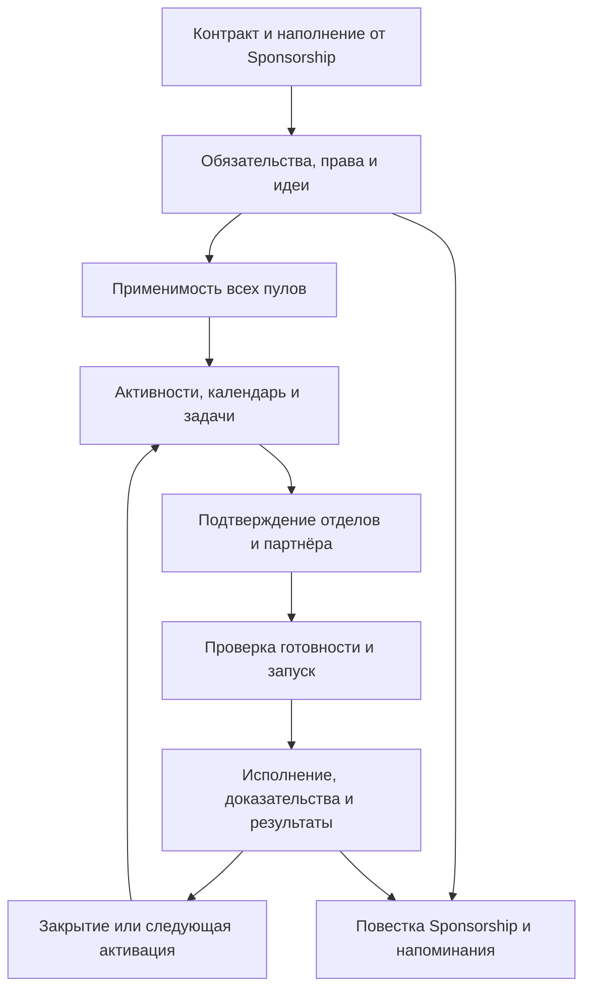

# Процесс активации партнёра после подписания

Обновление **2026-10-03**: в локальном MVP реализованы реестр прав/обязательств с остатками, применимость 16 пулов и 48 шаблонов, зависимости задач, подтверждение назначения и актуальная сверка договора перед закрытием. [Реализованное поведение](../proverka-i-ispolnenie.md). Автоматические внешние напоминания, назначения отделам и разбор файлов договора остаются открытыми; [нужные входы](../../../tasks/paket-zadach-dlya-otdelov-2026-10-03.md). Нижний статус и таблицы 2026-10-01 описывают исходное проектирование.

Дата: 2026-10-01. Версия: 0.1. Статус: подготовленный процесс для проверки на первом партнёре. Это проект работы отдела Sponsorship; описанные ниже автоматические функции ещё не реализованы.

Задача владельца: получать из контракта и свободного описания возможностей понятный план активации амбассадора, инфлюенсера, команды или другого партнёра. План должен охватывать обязательные пулы, связывать работу отделов, напоминать о договорных возможностях и сроках, показывать исполнение и результаты. Sponsorship ведёт прямую коммуникацию с партнёром и координирует внутреннюю работу.

Владелец отдельно подтвердил: собрать общий набор пулов из всех файлов архива, затем проверять применимость каждого пула для конкретного партнёра. Состав из 16 пулов, правила переходов, поля и интервалы напоминаний ниже — предложение исполнителя. Прочитанные архивные примеры не утверждают текущие права, сроки или назначения людей.

## Как этим пользоваться

1. Владелец присылает наполнение сотрудничества обычным сообщением и указывает актуальные материалы.
2. Codex заполняет [карточку кампании](shablon-kampanii.md), отделяя условия контракта, доступные права, идеи и вопросы.
3. Для всех [16 пулов](puly-i-zadachi.md) появляется решение о применимости. По нужным пулам собираются активности и задачи.
4. Sponsorship проверяет полноту договора и подтверждает приоритеты; отделы подтверждают исполнителей и сроки.
5. По общей дорожной карте проходит подготовка, запуск, повторяющиеся активации и закрытие. Личная повестка Sponsorship собирается из тех же записей.

Выход одной подготовки: карточка партнёра, реестр обязательств и прав, матрица пулов, календарь активностей, задачи отделам, черновики коммуникаций и перечень ближайших решений. Неизвестные поля остаются вопросами; задачи без подтверждённого исполнителя видны в очереди назначения.

## 1. Что ведём

**Партнёрство** — отношения с одним партнёром и конкретная версия договора. **Активация** — отдельный запуск: анонс, съёмка, публикация, матч, мероприятие, CRM-кампания. **Задача** — проверяемая работа одного исполнителя внутри активации. У одного партнёра может быть несколько договоров и много активаций; общий календарь не заменяет их раздельный учёт.

| Основание записи | Пример | Что с ним делать |
| --- | --- | --- |
| Обязательство по контракту | Партнёр размещает контент; компания предоставляет материалы или проводит оплату | Сохранить точный пункт, объём, период и сторону исполнения; разложить на экземпляры и задачи |
| Доступное право | Съёмочный день, билеты, использование образа, рекламное продвижение контента | Вести остаток, окно использования и крайний срок запроса; предложить активацию или вынести решение на повестку |
| Обязательная внутренняя проверка | Уточнить применимость CRM; проверить рабочую ссылку перед публикацией | Записать результат проверки и применимость; это не обещание партнёра |
| Дополнительная идея | Совместный спецпроект сверх пакета | Поместить в идеи с целью, затратами и необходимыми правами; не превращать в согласованную задачу |

Отдельно хранятся **источник** и **статус подтверждения**. Фраза владельца «у нас есть съёмка» — предоставленное сведение до сверки пункта договора. Привязка к исходнику не заменяет подтверждения его актуальности человеком.

## 2. Вход и проверка полноты

Для черновика достаточно названия/типа партнёра и описания возможностей. Для исполнимого плана нужны версия подписанного договора с приложениями, территория, язык, начало/конец, сроки уведомлений, перечень прав и обязательств, дата первого запуска, владелец со стороны Sponsorship, контакт партнёра и доступные бюджеты с валютой и периодом. Отсутствие этих полей не мешает подготовить черновик, но оставляет конкретные задачи без подтверждённых дат или условий.

Порядок разбора:

1. Сохранить исходное сообщение и перечень файлов с версиями. Найти расхождения между договором, приложением и рабочей таблицей.
2. Выписать обязательства **обеих сторон**, права, ограничения, согласования, оплату, требования к отчётам, срокам запросов и окончанию использования материалов. Юридические трактовки направить профильному специалисту.
3. Составить покрытие разделов: для каждого раздела/приложения отметить связанные записи либо «операционных действий нет» с проверяющим. Непрочитанные приложения и неоднозначные пункты оставить видимыми.
4. Разделить повторяющиеся объёмы на периоды. «Ежемесячная публикация» требует отдельных месячных экземпляров, а не одной бессрочной задачи.
5. Sponsorship вручную сверяет реестр с актуальным контрактом. Записываются кто, когда и какую версию проверил. Процент заполненных строк сам по себе не доказывает полноту договора.

В карточке обязательства: ID, источник и пункт, дословное условие в закрытом рабочем файле, понятная формулировка, сторона исполнения, количество и единица, период/частота, срок и часовой пояс, нужное согласование, критерий приёмки, связанные активности, доказательства и статус. Суммы, контакты и текст реальных договоров хранятся в закрытых материалах.

## 3. Как не забыть доступные права

Право остаётся в реестре, даже если для него пока нет идеи. Для каждого права нужны: объём, единица, окно действия, срок подачи запроса, ограничения территории/каналов, подтверждённые бронирования, принятое использование, остаток и следующее действие Sponsorship.

- Статусы: не рассмотрено → предложено → запрошено → подтверждено/забронировано → использовано и принято. «Истекло», «отказались использовать» и «условия неизвестны» видны отдельно.
- Дата решения рассчитывается от **самого раннего** ограничения: срока запроса партнёру, времени подготовки, окончания права или события. Напоминания за несколько дней до окончания недостаточно, если подготовка занимает месяц.
- Остаток считается только при известном объёме и сопоставимых единицах/периодах. Забронированное уменьшает доступный к планированию остаток; использованное списывается после приёмки. Одна активация не списывает одно право дважды.
- Новый резерв не должен превышать подтверждённый свободный остаток; конфликт выносится на решение. При неизвестном объёме нельзя подтверждать численный остаток или доступность бронирования автоматически.
- При отмене бронирования резерв освобождается после фиксации статуса. Истечение не превращает неиспользованное право в выполненное.
- Неиспользование доступного права требует коммерческого решения с причиной. Отказ от договорного обязательства отдельно требует основания и фактического согласования уполномоченных сторон; отметка в трекере договор не меняет.

## 4. Пулы, активности и календарь

Все пулы P01–P16 проходят проверку применимости. Возможные ответы: **применяется**, **не применяется с причиной**, **нужно уточнить**. Отсутствие ответа не означает «не применяется». Если пул применяется, у него есть ведущий отдел, конкретный ответственный после подтверждения и ожидаемый результат.

Sponsorship связывает выбранные идеи и обязательства с активациями. Для каждой активации фиксируются цель, аудитория, канал, используемые права, бюджет, дата, зависимости, материалы, согласования и измерение результата. Разделение «нужно выполнить по контракту / используем право / предлагаем дополнительно» сохраняется в календаре.

План строится от события назад: публикация зависит от согласования материала, рабочего адреса перехода и готовности измерения; согласование зависит от готового материала и времени ответа партнёра. Роль-исполнитель в шаблоне — кандидат на назначение, а не подтверждение занятости человека.

Обозначения дат: **L** — первый публичный запуск, **E** — конкретное событие, **X** — окончание права, **R** — договорный срок уведомления/запроса. L и начало договора могут отличаться. Если дата неизвестна, задача получает триггер и вопрос вместо выдуманного дедлайна. Для каждой даты указывается местный часовой пояс; личная сводка владельца может отображаться по Europe/Riga. Рабочие дни и праздники отделов уточняются отдельно.

При переносе E или L пересчитываются только связанные относительные сроки. Фиксированные договорные даты сохраняются; конфликт становится отдельным решением. Первоначальный согласованный план и история переносов остаются доступны.

## 5. Ответственность и передача задач

| Участник | Ответственность в предлагаемом процессе |
| --- | --- |
| Sponsorship | Полнота плана, связь с контрактом, коммуникация с партнёром, внутренняя координация, повестка и эскалация |
| Руководитель подключённого отдела | Назначить исполнителя, подтвердить ресурс/срок либо сообщить конфликт и альтернативу |
| Исполнитель | Сделать конкретный результат, сообщить о блокере, приложить подтверждение |
| Принимающий | Сверить результат с критерием приёмки; вернуть на доработку или принять |
| Country Manager / локальная команда | Проверить применимость и адаптацию под рынок, местный календарь и исполнение на месте |
| Владелец бюджета / C-level | Принять решения в пределах своих полномочий: концепция, бюджет, существенные изменения и итог |
| Партнёр / представитель | Подтвердить доступность, материалы, даты и выполнение своей части через Sponsorship |

У задачи один ответственный за результат; помощники и принимающий указаны отдельно. Контакт с партнёром проходит через Sponsorship. Внутреннюю техническую приёмку выполняет профильный отдел. Полномочия по старту и исключениям фиксируются в карточке кампании, не выводятся из должности автоматически.

Состояние поручения: **черновик → предложено отделу → принято в работу → выполняется → передано на проверку → принято**. Возможны «заблокировано», «нужна доработка», «отменено с основанием». Просрочка — отдельный признак поверх статуса. Передача сообщения, подтверждение получения и принятие задачи — разные события.

Минимальная задача: ID активации и пункта/основания, ожидаемый результат, отдел, исполнитель, принимающий, начало/срок, зависимости, критерий приёмки, ссылка на материалы, следующий шаг, статус и доказательство. Если исполнитель ещё не назначен, Sponsorship получает задачу назначения с адресатом-руководителем и сроком ответа.

## 6. Коммуникации и согласования

| Триггер | Что готовит Sponsorship | Как понять, что передача состоялась |
| --- | --- | --- |
| Партнёрство подписано | Стартовый бриф отделам: что включено, ограничения, цель, старт, права, нужный результат каждого отдела | Получатель подтвердил ознакомление; отдел назначил ответственного либо обозначил вопрос |
| Нужна работа отдела | Короткое поручение со ссылкой на карточку, результатом, входами и сроком ответа | Подтверждён конкретный исполнитель и согласована дата |
| Нужен ответ партнёра | Запрос даты/материалов/согласования с номером версии и сроком | Сохранён фактический ответ представителя и предмет согласования |
| Поменялись дата, права, материал или бюджет | Список изменений, затронутые задачи, требуемые решения | Нужные стороны подтвердили новую версию; старые согласования явно пересмотрены |
| Приближается запуск | Сводка готовности, открытые блокеры и решение о старте | Зафиксированы решение уполномоченного человека, время и разрешённый объём |
| Завершён период | Исполнение, результаты, остатки прав, проблемы и следующие активности | Назначены действия по отклонениям; итоги приняты ответственным |

Вместо пересылки полного контракта каждому отделу можно дать рабочую выжимку и доступ к нужным пунктам согласно внутренним правилам. Журнал коммуникаций хранит адресата, версию, дату фактической отправки, ссылку на сообщение, ожидаемый ответ и подтверждение. До отправки это черновик. В этой сессии сообщения и внешние задачи не отправлялись.

Согласование относится к конкретной версии материала, каналу, территории и периоду. Существенная замена не наследует его автоматически. Отсутствие ответа не является согласованием.

## 7. Личная повестка и напоминания

Главный экран Sponsorship должен отвечать на пять вопросов: **что сделать мне; кому написать; что блокирует ближайший запуск; какие права можно потерять; где нет подтверждения или результата**. Представления по партнёру, отделу и календарю используют общие записи, без отдельных несвязанных списков.

Предлагаемые правила для пилота; точное время, каналы и интервалы пока не выбраны:

| Повод | Правило формирования повестки | Адресат / следующий шаг |
| --- | --- | --- |
| Задачи владельца | По запросу показывать сегодня, просроченное и ближайшие 7 дней; при подключении расписания — один утренний дайджест по рабочим дням | Sponsorship: выполнить, уточнить дату или назначить исполнителя |
| Срок задачи | Предлагаемые напоминания за 3 и 1 рабочий день; договорные и согласованные сроки имеют приоритет | Исполнитель; Sponsorship видит блокирующие работы |
| Не приняли поручение / нет ответа | Напомнить при наступлении установленного срока ответа; предложенная следующая эскалация — через 1 рабочий день | Сначала адресат, затем руководитель отдела по согласованному маршруту |
| Просрочка / блокер | Показать причину, что сорвётся, кому нужен ответ и дату решения; критический блокер перед стартом — сразу в повестку | Sponsorship координирует, владелец решения разрешает конфликт |
| Неиспользованные права | Еженедельно просматривать свободный остаток; напомнить до рассчитанной даты решения с учётом запроса и производства | Выбрать активацию, забронировать или осознанно отказаться |
| Повторяющееся обязательство | Создать отдельный экземпляр на каждый период с датой подготовки, согласования и сдачи | Проверить план/факт именно этого периода |
| Отчёт и приёмка | Напомнить в установленное окно получения статистики и ответа принимающего | Получить файл/выгрузку или принять результат |
| Продление и окончание | Отсчитывать подготовку от договорного срока уведомления, окончания прав и времени решения | Решить о продолжении; подготовить отключение и архив |

Напоминание содержит партнёра, задачу/право, реальную дату, последствие задержки, требуемое действие и ссылку. После приёмки или обоснованной отмены будущие напоминания об исполнении снимаются. Передача на проверку переключает следующий запрос на принимающего; ожидаемый отчёт остаётся самостоятельной задачей. После изменения даты старые напоминания отменяются; перенос не стирает историю просрочки. Для «отложить» нужна новая дата, для «ждём» — конкретный адресат и контрольный срок.

При подключении доставки нужны защита от повторной отправки, учёт версии срока, видимый статус сбоя и проверка следующего запуска. Сводка в локальном MVP не равна доставленному напоминанию. Расписание этого процесса в текущей сессии не создавалось; ранее согласованное напоминание по исследованию не менялось.

**Недельная повестка:** обязательства ближайших периодов; права без плана; новые предложения отделов; непринятые поручения; блокеры и переносы; материалы на согласовании; план/факт и недостающие отчёты; решения владельца. По каждому пункту записывается действие, человек и срок, а не только обсуждение.

## 8. Готовность, запуск и контроль

До первого выхода Sponsorship собирает решение по применимым условиям: права и точная версия контента подтверждены; дата согласована с партнёром; технический путь и измерение проверены; нужные продуктовые/медийные/локальные команды готовы; поддержка получила инструкции; финансовые условия для старта выполнены; блокирующие задачи закрыты. Обязательные предпосылки конкретного договора нельзя отменить внутренним чекбоксом.

Статусы готовности: «готово», «есть блокер», «нужно решение». Уполномоченный человек разрешает старт конкретного объёма или перенос. Частичный запуск перечисляет включённые и отложенные активности. Проверка ссылки и тестовое событие выполняются в тестовом режиме; проверка не требует настоящей оплаты, рассылки или обращения клиенту.

После выхода собираются ссылка/скриншот/отчёт, время, фактический объём и отклонения. Для исчезающего контента заранее назначается ответственный за фиксацию. Закрытие технических задач не означает автоматической приёмки договорного обязательства. Оно принимается отдельно по доказательствам; результат кампании может быть измерен позже.

## 9. Что измерять

| Уровень | Пример | Правило |
| --- | --- | --- |
| Работа команды | Просрочки, неподтверждённые поручения, время ожидания согласований | Считать по задачам и датам; не называть маркетинговым эффектом |
| Исполнение контракта | Публикации за период, использованные съёмочные часы, подтверждённые размещения | Сравнивать одинаковые единицы; принятые, отменённые и неисполненные показывать отдельно |
| Использование прав | Доступно, забронировано, использовано, истекает без плана | Считать по праву и периоду; не складывать билеты с публикациями в один процент |
| Результат активности | Брендированные показы, переходы, подтверждённые действия, выбранная метрика узнаваемости | Определить источник, окно, единицу и владельца сбора до запуска; неизвестное не равно нулю |
| Расходы | Права/гонорар, производство, размещение, логистика, измерение и другие затраты | Разделять план, обязательства и фактические расходы; сохранять валюту/период и неполноту |

Архивный процесс предлагает срезы раз в две недели первые два месяца, затем ежемесячно. Это исходный вариант для обсуждения; периодические обязательства и отдельные события проверяются по собственным срокам. Еженедельная операционная сверка может идти независимо от маркетингового отчёта.

Первоначальные цели и план сохраняются рядом с текущим планом и фактом. Изменение цели не улучшает старый результат задним числом. Сумма охватов каналов не считается уникальным охватом без удаления пересечений. Переходы по ссылке показывают наблюдаемый путь, но сами по себе не доказывают добавочный эффект. Продажи и ROI в этой задаче не прогнозируются; измерения описаны в [словаре показателей](../../../research/slovar-pokazateley.md).

## 10. Изменения и завершение

Изменение контракта, активации, даты, объёма, бюджета или материала получает причину, автора, новую версию, затронутые задачи и нужные согласования. Новая идея сначала попадает в предложения. При переносе съёмки видны связанные креативы, медийные выходы, бронирования и сроки прав. Устаревшие задачи отменяются с историей, а не исчезают.

При завершении сверяют каждое обязательство и оставшиеся права, принимают доказательства, отмечают нарушения/замены, получают отчёты и подтверждённые затраты. Далее фиксируют решение «продлить / изменить / завершить» и уроки. Неизвестный результат остаётся неизвестным.

Отдельно проверяются конечные даты рекламы, изображений, логотипов, лендингов, кодов и публичных публикаций. Архив содержит идею бессрочного сохранения открытого контента, но применять её можно только в пределах конкретных прав и решения профильного специалиста. Завершение промо и отключение страницы планируются с владельцем продукта, чтобы сохранить нужный пользователям путь и отчётные данные. Архивирование исходников не означает право продолжать рекламное использование.

## 11. Что уже есть и что предстоит реализовать

Сверка с кодом и [руководством MVP](../rukovodstvo-mvp.md) выполнена 2026-10-01. Сейчас есть задачи с ответственным/датой, блокеры, следующий шаг, материалы приёмки, недельная сводка, план/факт и история. В коде статусы задач: planned, in_progress, blocked, submitted, accepted, waived. Развёрнутый процесс этого документа поверх них пока не реализован.

| Очередь предложения | Работа | Критерий готовности |
| --- | --- | --- |
| A1 | Пройти вручную одну кампанию по шаблону, не повторяя этапы поиска | Проверены договор и все пулы; сформированы активности, задачи, вопросы и повестка |
| A2 | Добавить реестр обязательств/прав, их периодов и связь с активностями | Видны непокрытые пункты, повторяющиеся экземпляры, остатки и сроки запроса; история изменений сохраняется |
| A3 | Добавить применимость пулов, зависимости, подтверждение назначения и согласования версий | Незадействованный отдел, непринятая задача или устаревшее согласование не отображаются как готовность |
| A4 | Добавить личную повестку, затем согласованный канал напоминаний | Проверены срок/часовой пояс, повторный запуск без дублей, перенос, отмена и ошибка доставки |
| A5 | Связать приёмку, измерения, затраты и закрытие | Отдельно видны выполнение, эффективность и пробелы; отчёт сохраняет исходный план |

Существующие поля MVP требуют доработки для количественных прав, контроля полноты контракта, регулярных экземпляров, подтверждения получения и доставки напоминаний. Есть отдельная потребность: открыть исполнение по уже подписанному партнёру без выдуманного ресерча и исторических согласований. Сейчас создание кампании требует исследовательского состояния и одобренного оффера; до доработки используется рабочий шаблон.

Очередь A1–A5 — план развития этого блока. Реальных назначений, записей о человеческих согласованиях, фоновых уведомлений и рассылок при подготовке документа не создавали.

## Основания и оставшиеся входы

Прочитаны 8 таблиц и 1 документ из `anonymized_sponsorship_files.zip`; дата чтения 2026-10-01. [Карта источников и правила объединения](istochniki-i-proverka.md) отделяет архивную практику от предложений. Детальные извлечения хранятся в `data/private/activation-plan-2026-10-01/`, исходный архив сохранён без изменений.

Для первого применения нужны конкретное наполнение, актуальный контракт, дата запуска, названия/руководители нужных отделов и рабочее место постановки задач. Для автоматических напоминаний отдельно нужны канал, часовой пояс получателей и расписание. Эти входы не требуются для оценки самого предложенного процесса.
