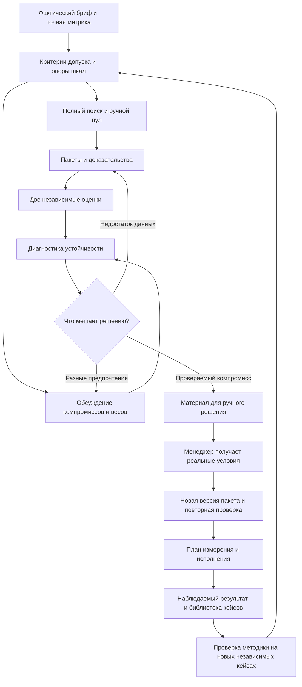

# Устойчивость решения и очередь дальнейших работ

Дата: **2026-10-01**. Подготовлено по открытому поручению владельца качественно доработать проект. Статусы ниже разделяют реализованную программу, предложения исполнителя и ещё не полученные свидетельства. Продажи и ROI не прогнозируются.

## Что сделано в этом проходе

Добавлена команда `python sponsor.py diagnose`: она читает существующее исследование без записи в SQLite, проверяет чувствительность сравнения к весам/оценкам, показывает пробелы и создаёт HTML, Markdown или JSON. [Руководство](../../docs/product/rukovodstvo-mvp.md#диагностика-устойчивости).

Подготовлен [наглядный синтетический отчёт](../../data/exports/diagnostika-ustoychivosti-2026-10-01/diagnostika.html) с графиком диапазонов, матрицей допуска, раскрываемыми парными сценариями, вопросами для проверки и зависимостями от источников. Экспорт находится в игнорируемой папке; воспроизводимый генератор — [demo_diagnostics.py](../../scripts/demo_diagnostics.py).

Практический результат примера: **81,5 против 81,1 не означает устойчивого преимущества**. При отклонении каждого веса не более чем на 5 процентных пунктов и общей сумме 100% разность первого и второго лежит от **−0,6 до +1,4**. Оба порядка возможны. Настройка ±5 п.п. выбрана для демонстрации, не получена из исследования предпочтений владельца.

У клуба с неизвестной оценкой аудитории размах этого пропуска составляет **35 баллов** при исходных весах. Для равенства с текущим лидером нужны 100/100 по аудитории при неизменных остальных оценках и весах. Это вопрос к доказательствам, а не задание поставить 100. Пакет автора с непроверенным риском не участвует в сравнении даже при полном покрытии оценок.

## Что сейчас действительно дорабатывается

Сверка выполнена по [приоритетам](../../PRIORITIES.md), [roadmap](../../tasks/razrabotka-mvp.md), [архитектуре](../../docs/architecture/lokalnyy-mvp.md), [движку](../../packages/scoring/engine.py), [контрактам ролей](../../agents/README.md), списку сохранённых исследований и методологическому обзору от 2026-10-01. В рабочей базе на момент проверки были три исследования с типом `synthetic`; фактический брендовый пилот этим не подтверждается.

| Блок | Уже есть | Что остаётся открытым | Что будет свидетельством продвижения |
| --- | --- | --- | --- |
| Сквозной процесс | Шесть этапов, история, версии, CLI/браузер, ручные решения | Работа на фактическом брифе | Сохранённый бриф, исполненный план поиска, фактический ручной пул |
| Сравнение | Предварительная шкала и профили; теперь диагностика чувствительности | Смысл опор шкалы и обоснование предпочтений | Независимые оценки одного набора материалов и разбор расхождений |
| Доказательства | Источники, даты, доступ, ссылки критериев | Проверка содержательной пригодности, общих ошибок и происхождения | Матрица «утверждение — фрагмент — период — популяция — проверка» |
| Аудит цены | Статус цены, состав затрат, проверки сопоставимости | Реальные пакеты и сопоставимые аналоги | Обезличенные офферы с правами/сроком/территорией; объяснимый отказ от вилки при нехватке данных |
| Узнаваемость | Цель названа; методики изучены | Точная метрика и дизайн измерения | Определение результата, популяция, период, инструмент и допустимый вывод |
| Исполнение | Задачи, владельцы, сроки, приёмка, план/факт | Сопоставление с процессом компании | Перенос реальных обязательств в задачи с проверкой полноты человеком |
| Автономный ресерч | Контекст ролей и атомарный импорт | Очередь, отмена, идемпотентность, фактические расходы и доступы | Изолированный испытательный прогон с повтором/сбоем/остановкой и журналом |
| Командная версия | Локальная база и экспорт | Учётные записи, права, резервирование, инфраструктура | Отдельный проверенный проект развёртывания и восстановления |

## Предлагаемая карта зависимостей

Стрелка означает необходимый вход. Это **предложение очереди**, без назначенных сроков и согласований владельца.



Доступы, лимиты и обработка сбоев нужны автоматизации. Они не заменяют бриф, выбор владельца, свидетельства цены или проверку методики. Масштабирование поиска разумно оценивать после измерения качества и стоимости хотя бы одного полного процесса.

## Очередь полезных следующих работ

Обозначения A–F — порядок предложения, не утверждённый roadmap. Трудоёмкость и сроки без исходных материалов не назначены.

| Очередь | Работа | Зависимости / чей вход | Что можно поручить Codex | Критерий завершения |
| --- | --- | --- | --- | --- |
| A | Паспорт первого пилота | Владелец: фактический бриф, метрика узнаваемости, ЦА, бюджет и период | Нормализовать сообщение, сохранить вопросы и версии | Неизвестное явно обозначено; запуск соответствует обязательным полям MVP |
| B | Карточка существенного утверждения | Конкретные материалы кандидата/пакета | Разнести измерение, заявление стороны, гипотезу и вывод; сопоставить противоречия | Любой существенный вывод прослеживается до прочитанного фрагмента и применимого периода |
| C | Калибровка рубрик двумя людьми | Один неизменный набор материалов, два оценщика | Подготовить слепые формы, посчитать расхождения, сгруппировать причины | Сохранены исходные независимые оценки, изменённые определения и нерешённые разногласия |
| D | Аудит конкретного оффера | Обезличенный реальный пакет, цена, права и затраты | Проверить полноту, сопоставимость и сформировать вопросы менеджеру | Есть обоснованный вывод по конкретным условиям либо явный отказ от ценового диапазона |
| E | Проверка результата | Кампании, исходный план, фактические выгрузки и затраты | Привести единицы/периоды, исследовать ошибки и пропуски | Результат измерения отделён от причинного эффекта; настройка и проверка разделены |
| F | Автономная очередь | Пилот источников и цены вызовов, согласованные доступы | Спроектировать и проверить retry/cancel/cache в изоляции | Повтор не дублирует записи/расходы; лимит и отмена реально останавливают работу |

Наиболее полезный ближайший вход — **один конкретный бриф и один обезличенный пакет**, а не ещё один общий список методик. Это позволяет проверить качество карточки доказательств и понятность решения ещё до сбора большого массива кампаний. Один кейс не валидирует модель.

## Реализованная математическая диагностика

Пусть исходные веса `w₀` суммируются в 1, а `r` — указанное пользователем отклонение в долях единицы:

```text
max(0, w₀ᵢ − r) ≤ wᵢ ≤ min(1, w₀ᵢ + r);  Σwᵢ = 1.
Пригодная оценка: xᵢ ∈ [max(0, sᵢ − d), min(100, sᵢ + d)].
Непригодная/неизвестная оценка: xᵢ ∈ [0, 100].
Разность пары: Δ(A,B) = Σwᵢ(xAᵢ − xBᵢ).
```

Для каждой пары используются **одни и те же веса**. Нельзя вычитать независимый минимум одного пакета из независимого максимума другого: такие экстремумы могут соответствовать разным предпочтениям.

Реализация находит минимум/максимум линейного выражения на ограниченной области весов: начинает с нижних границ и распределяет оставшийся вес по коэффициентам в порядке выгодности. Корректность следует из обмена: перенос веса от худшего коэффициента к лучшему, пока его верхняя граница не достигнута, не ухудшает целевое значение. Для интервалов оценок берутся соответствующие концы, поскольку веса неотрицательны. Независимый тест перебирает вершины допустимой области.

Результаты пары:

| Диапазон Δ | Интерпретация |
| --- | --- |
| Весь строго выше нуля | A выше B во всей заданной области |
| Весь строго ниже нуля | B выше A во всей заданной области |
| Есть отрицательные и положительные значения | Порядок может меняться |
| От нуля до положительного / от отрицательного до нуля | Не хуже во всей области; возможно равенство |
| Только ноль | Постоянное равенство |

Числовой допуск `1e-8` предназначен для ошибок вычисления, не является порогом практической значимости. Значения отображаются до четырёх знаков, решения о знаке принимаются до форматирования.

Границы места: `1 + число обязательно превосходящих` … `1 + число способных превосходить`. Это **консервативная внешняя граница**, поскольку лучшие для разных пар условия могут не реализоваться одновременно. Равенство не считается превосходством. Текущее место вычисляется только при полных пригодных оценках и отсутствии ограничений; условный диапазон места не заполняет пропуски.

Перед диагностическим сравнением сохраняются ограничения текущего движка. Дополнительно период и территория проверяются даже при неизвестной цене: ранний выход расчёта экономики не должен делать несопоставимые пакеты сравнимыми. Основные веса и поведение существующей команды сравнения не менялись.

### Границы реализованного метода

- Диагностика действует внутри существующей предварительной аддитивной модели. Она не доказывает интервальность рубрики, независимость критериев или допустимость компенсации.
- Интервалы оценок задаются как независимые. Общие ошибки медиакита, систематическая предвзятость и корреляции не моделируются; область может быть слишком широкой.
- Структурная пригодность источника наследуется от MVP (`page_read` / `provided_material`), а не устанавливает истинность и содержательную применимость текста. Карта источников показывает только зависимости ссылок критериев.
- При изменении брифа старые границы не показываются: сначала требуется переоценка пакета. Срок действительности реальной цены и доступность человека не проверяются автоматически.
- Ширина пропуска помогает сформулировать вопрос. Это **не EVSI/EVPI**: нет вероятностей исходов, функции потерь, цены исследования и модели решений.
- Устойчивость в заданной области не является переносимостью между странами, вероятностью успеха, прогнозом охвата или оценкой ROI.

## Основания и источники

Источники прочитаны **2026-10-01**. Ни один не содержит валидации Sponsorship Activation или его весов. Ниже краткие пересказы; конкретный алгоритм и контракт вывода выше — самостоятельное техническое решение исполнителя.

| ID | Первичный источник и дата | Что прочитано и применено | Граница переноса |
| --- | --- | --- | --- |
| U01 | [HM Treasury: MCDA in options appraisal](https://www.gov.uk/government/publications/green-book-supplementary-guidance-multi-criteria-decision-analysis/use-of-multi-criteria-decision-analysis-in-options-appraisal-of-economic-cases), обновление 2024-05-16 | HTML, §§4.3–4.5: документировать разногласия, обосновывать компромиссы, исследовать смену порядка при изменении весов и оценок | Метод для государственных решений; не источник спонсорских коэффициентов. В проекте сохранены фиксированные опоры шкалы, а не перенесена нормализация по лучшему/худшему кандидату из учебного примера |
| U02 | [OECD / EU / JRC: Handbook on Constructing Composite Indicators](https://www.oecd.org/content/dam/oecd/en/publications/reports/2008/08/handbook-on-constructing-composite-indicators-methodology-and-user-guide_g1gh9301/9789264043466-en.pdf), 2008 | Текст PDF, §1.7 и Step 7, печатные с. 34–35 и 117: исследовать влияние допущений, пропусков, весов и агрегирования; документировать устойчивость | Руководство о составных индикаторах; устойчивость не заменяет содержательной модели. PDF не заявляется прочитанным полностью |
| U03 | [HM Treasury: The Green Book 2026](https://www.gov.uk/government/publications/the-green-book-appraisal-and-evaluation-in-central-government/the-green-book-2026), 2026 | HTML, раздел Methods of longlist appraisal: отличать обоснованную MCDA от простой суммы субъективных баллов | Политика британской оценки проектов не становится обязательным правилом частного LATAM-продукта; отсюда нельзя объявить MVP сертифицированной MCDA |

Поиск: два запроса; три открытия первичных источников; два поиска по прочитанным документам. Начальный отдельный лимит — четыре запроса и шесть операций чтения, включая поиск по странице; израсходовано 2/4 и 5/6. Тарификация не предоставлена (`null`, не ноль). Журнал и ответы находятся в `data/private/ustoychivost-2026-10-01/`. Методологические источники не импортировались как доказательства о кандидатах.

[Готовые поручения](prompty-proverki.md) · [Протокол локальной проверки](../../tests/proverka-diagnostiki-2026-10-01.md) · [Код](../../packages/scoring/diagnostics.py).
